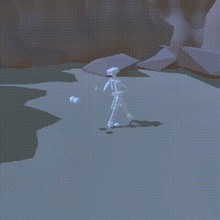

This is a simple procedural walk/run animation. It relies solely on an externally supplied world-space movement vector.
Walking and running are fundamentally the same thing — the parameters on each Movement entry independently control the arm-swing curve and the leg-lift curve. 
It is more of a personal exercise than a mature solution.
It need Rigging Animation Package.

Note: the PA class does not handle character turning or camera movement — those are provided by the Camera class. 
You are free to use your own camera setup; PA only needs a world-space movement vector.

P.S. You can add new motion states to the movements list — a jog, a sprint, or anything else — depending on the KeyCode and parameters you assign.
I am suck at English,sorry about that.
VideoLink:https://www.bilibili.com/video/BV1Nnxq61ENf
